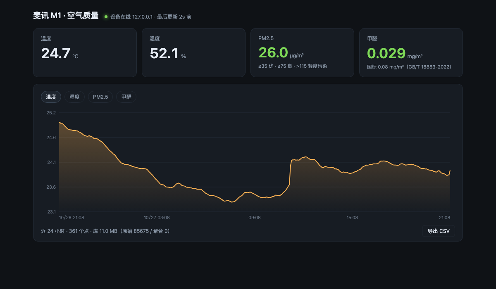
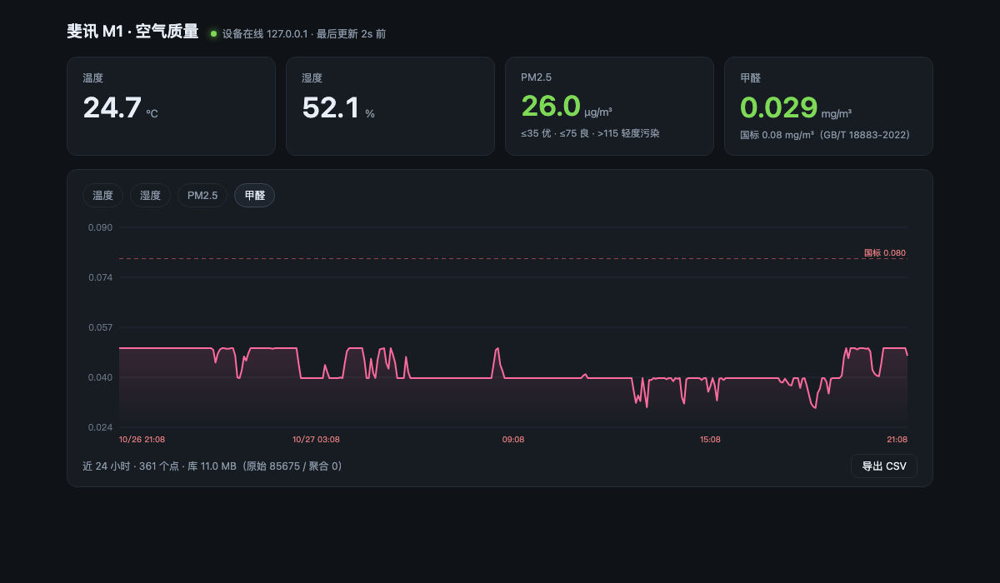
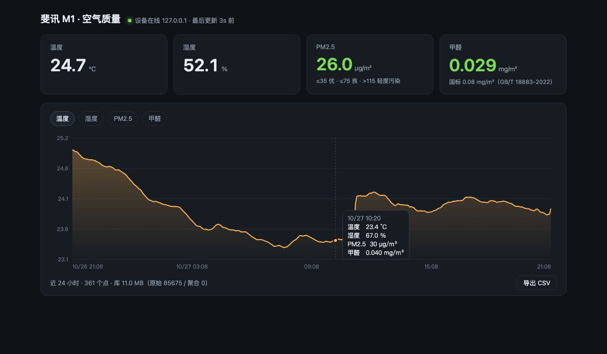

# 斐讯 M1（悟空）空气检测仪 · 本地服务器 + 网页面板

> 厂商倒闭、云端关停之后，让这台停产的空气检测仪继续工作。
>
> 不刷机、不改硬件，用一台常开的机器冒充它记忆里那个已经死掉的服务器。

斐讯 M1（悟空）内置 PM2.5、甲醛、温度、湿度传感器，原厂靠 `aircat.phicomm.com`
下发指令、上传数据。斐讯 2018 年出事之后服务器关停，设备变成一块只显示数字的砖。

但它每次开机都会主动去连那个域名。只要在局域网里让这个域名指向你自己的机器，
再按原厂协议应答，设备就“回来了”。



## 特性

- **纯本地**：数据不经过任何第三方服务器
- **不刷机**：原厂固件即可，只做 DNS 劫持 + 协议模拟
- **零依赖**：只用了 Python 标准库，不需要 `pip install`
- **每 5 秒一条**：温度 / 湿度 / PM2.5 / 甲醛，写入 SQLite
- **网页看板**：实时值、可切换的历史曲线、悬停查看任意时刻、CSV 导出
- **自动归档**：原始数据保留 30 天，之后聚合成小时均值，体积不再增长
- **开机自启**：附带 macOS LaunchDaemon 安装脚本

<table>
<tr>
<td></td>
<td></td>
</tr>
</table>

## 原理

设备是 TCP **客户端**，不是服务器——它不监听任何端口，所以你扫端口是找不到它的。

| 项 | 内容 |
|---|---|
| 连接方向 | 设备主动连出 |
| 目标 | `aircat.phicomm.com:9000` |
| 服务器下发 | 固定帧 + `{"type":5,"status":1}` + `\xff#END#`，每 5 秒 |
| 设备回包 | 数据以 `#END#` 结尾，中间是 JSON |
| 字段 | `temperature`、`humidity`、`value`(PM2.5)、`hcho` |
| 亮度控制 | `{"brightness":"N","type":2}` |

几个实测细节：

- 帧头第 17~22 字节是**设备 MAC**，需要替换成自己那台的
- `hcho` 原厂单位是 **µg/m³**（上报 10 / 20 / 40），本项目统一折算成 mg/m³
- 传感器按 10 µg/m³ 一档量化，所以曲线是阶梯状，不是连续值

```
┌─────────┐    TCP 9000     ┌──────────────────────┐
│   M1    │ ───────────────>│  m1_server.py        │
│ (悟空)  │ <─────────────── │  心跳 / 解析 / 入库   │
└─────────┘   JSON + #END#   └──────────┬───────────┘
                                        │
                                SQLite ─┴─> 浏览器面板
```

## 快速开始

先用模拟设备跑通，不需要真机：

```bash
python3 m1_server.py --simulate
```

打开 <http://127.0.0.1:8787>，能看到数据在跳就说明链路正常。

## 接真机

### 1. 找到设备的 MAC

```bash
arp -a | grep -i phicomm
```

或者看路由器后台的设备列表，主机名通常是 `Phicomm-AirDetector`。

### 2. 让设备找得到你（DNS）

设备只认域名，所以要把它解析到跑本程序的机器。三种做法：

**A. 路由器上改（最干净）**

刷了开发版或能 SSH 的路由器，在 dnsmasq 里加一行，只影响这一个域名：

```
address=/aircat.phicomm.com/192.168.1.10
```

**B. 路由器 DNS 指向这台机器**

路由器后台把 DNS 改成手动，首选填跑本程序的机器 IP，备用填 `223.5.5.5`，
然后用 `--dns` 参数启动本程序。

**C. 刷第三方固件**

[zM1](https://github.com/a2633063/zM1) 是社区自制固件，刷完直接走 MQTT/UDP，
不需要 DNS 劫持。代价是拆机烧录。本项目针对**原厂固件**，不适用这条路。

### 3. 启动

```bash
# 只做服务器，DNS 交给路由器
python3 m1_server.py --device-mac <设备的MAC>

# 顺便接管 DNS（53 端口需要 root）
sudo python3 m1_server.py --dns --device-mac <设备的MAC>
```

给设备断电重上电，日志出现 `[tcp] 设备连入：...` 就通了。

## 部署成开机服务（macOS）

前台跑着的时候关掉终端，服务就停了；如果路由器 DNS 指着这台机器，全屋会断网。

```bash
./install-daemon.command <设备的MAC>
```

装成 LaunchDaemon：开机自启、崩溃重启、关终端不影响。

```bash
sudo launchctl bootout system /Library/LaunchDaemons/com.alexshuai.m1server.plist  # 停止
./uninstall-daemon.command                                                        # 卸载
tail -f /Library/Logs/m1server.log                                                # 日志
```

> **macOS 的坑**：LaunchDaemon 读不了 `~/Documents`、`~/Desktop` 里的文件
> （TCC 隐私保护，root 也不行，会报 `Operation not permitted`）。
> 所以安装脚本会把程序复制到 `/usr/local/m1-monitor` 再运行。

## 数据

| 路径 | 说明 |
|---|---|
| `/` | 网页面板 |
| `/api/state` | 当前状态 + 近 24 小时序列（面板每 5 秒拉一次） |
| `/api/history?hours=72` | 指定范围的序列 |
| `/api/export.csv` | 导出近 7 天数据 |

数据库默认是 `m1_data.db`（SQLite，WAL 模式）：

```sql
readings(ts INTEGER PRIMARY KEY, temperature, humidity, pm25, hcho, raw TEXT)
hourly  (ts INTEGER PRIMARY KEY, temperature, humidity, pm25, hcho, n INTEGER)
```

`raw` 保留原始 JSON 片段，以后要加字段（比如 TVOC）不用重新抓。

### 体积与归档

5 秒一条，一天约 1.7 万行、2.2 MB。

- 原始数据保留 **30 天**（约 66 MB）
- 超过 30 天自动聚合成小时均值，永久保留
- 归档后执行 `VACUUM` 回收磁盘

稳态 70 MB 左右，不会一直涨。`--retain-days 0` 可关闭归档。

## 参数

```
--simulate            模拟设备，演示用
--dns                 同时启动 DNS 劫持
--dns-port 53         DNS 端口（53 要 root）
--dns-upstream        doh（默认）或某个 DNS 的 IP
--device-mac          设备 MAC，用于拼装原厂帧
--advertise-ip        手动指定对外通告的 IP
--tcp-port 9000       设备侧端口
--web-port 8787       面板端口
--hours 24            面板默认时间范围
--retain-days 30      原始数据保留天数
```

### 关于 `--dns-upstream`

默认用 **DoH**（`https://223.5.5.5/resolve`）。这不是多余的设计：

如果跑本程序的机器上开着 Clash / Surge 这类代理，本机发出的 53 端口查询
（UDP 和 TCP 都算）会被劫持成 `198.18.x.x` 的假地址。一旦这台机器成了全屋 DNS，
其他设备拿到假 IP 就全部断网。DoH 走 443，不受影响。

改成 `--dns-upstream 192.168.1.1` 可以走路由器，但**上游不能是「会把查询转发回本机」
的那台设备**，否则查询会在两者之间无限打转。

## 常见问题

**面板打不开** —— 端口被占了？`lsof -nP -iTCP:8787` 看看。

**设备连不上** —— 在另一台机器上 `dig aircat.phicomm.com`，返回的应该是跑程序那台的 IP。

**连上了但没数据** —— 看日志有没有 `[tcp] 设备连入`，以及 `[tcp] <=` 那一行的十六进制。
有连接没数据通常是帧头 MAC 不对。

**重启后失效** —— 路由器的 DNS 别改回去，设备每次上电都会重新解析域名。

## 路线图

- [ ] 斐讯 A1 空气净化器联动（协议已探明：`aircleanerconnecter.phicomm.com:9000`，
      同样是 TCP 客户端，控制报文 `{"datatype":"control","data":{"speed":60,"mode":2}}`）
- [ ] 超标推送（Bark / 邮件 / 钉钉）
- [ ] 屏幕亮度定时（协议里已有 `type:2` 指令）
- [ ] Home Assistant / HomeKit 桥接

## 致谢

- [binss / homeassistant-phicomm-m1](https://github.com/qqq-qqqq/homeassistant-phicomm-m1)
  —— 最早把 M1 的局域网协议逆出来并写清楚的项目，本项目的心跳帧和字段定义来自这里
- [a2633063/zM1](https://github.com/a2633063/zM1) —— 自制固件与协议文档
- [BFG7274/phicomm-a1-local-purifier](https://github.com/BFG7274/phicomm-a1-local-purifier)
  —— A1 净化器的本地化方案，路线图里的联动参考

## 免责声明

本项目仅用于**自己拥有**的设备，在厂商停止服务后恢复其基本功能。
不修改设备固件、不上传任何数据、不绕过任何仍在运营的服务。

协议来自社区公开的逆向结果。设备与商标归原厂所有，本项目与其无任何关联。

## License

[MIT](LICENSE)
